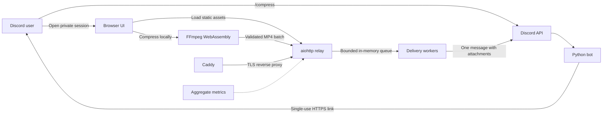

# Architecture

Professor Compressor keeps CPU-heavy video encoding in the user's browser.
The hosted service coordinates short-lived sessions and relays only completed
MP4 files to Discord.

## Trust and data boundaries

- Videos needing conversion or compression are processed by FFmpeg WebAssembly
  in the browser; their originals are not uploaded. Fitting MP4s may bypass
  recompression and be uploaded unchanged to the relay for Discord delivery.
- Finished MP4 files cross the HTTPS boundary and are held briefly in process
  memory while awaiting Discord delivery.
- The service does not write uploaded files to disk.
- Discord stores the final message attachments according to Discord's own
  policies.
- Session tokens are high entropy, short-lived, and can be claimed once. Opening
  a link creates a path-scoped, secure, HTTP-only browser cookie and a separate
  upload secret. A same-browser refresh rotates the upload secret; another
  browser cannot reuse the claimed link.

## Request lifecycle

1. `/compress` creates an expiring upload job tied to the requesting user and
   channel.
2. The browser claims the one-use link and receives the compressor interface.
3. The browser checks file signatures and compresses selected videos locally.
4. Completed MP4 files are uploaded as one multipart batch with automatic
   retry.
5. The relay verifies MP4 structure and enforces file, batch, concurrency,
   memory, and rate limits.
6. A bounded worker queue sends every result in one Discord message and then
   releases the in-memory bytes.

## Operational model

The current deployment is intentionally single-process and uses in-memory
state. This keeps the small deployment simple, but it means sessions, queue
contents, and aggregate metrics disappear on restart. Horizontal scaling would
require shared session storage and a durable external queue.

`/healthz` reports liveness, release revision, and current queue pressure.
`/readyz` checks Discord, command synchronization, workers, and maintenance state.
`/metricsz` reports
process-lifetime aggregate usage counters. Metrics never include user IDs,
guild IDs, channel IDs, filenames, IP addresses, or file contents.

## Code boundaries

The runtime is organized as a Python package whose subpackages have narrow,
one-directional responsibilities:

- `config.py` is the only environment parsing boundary. It validates numbers,
  URLs, and Discord IDs, and prevents secret values from appearing in object
  representations. `domain.py` defines upload jobs, delivery requests, browser
  results, and the explicit job-state machine. `branding.py` holds the public
  application identity and listing URLs; `paths.py` locates packaged
  templates, static files, and browser assets.
- `app/` composes the process. `runtime.py` is the composition root: it
  constructs a `Runtime` from validated settings and wires the session
  registry, rate limiter, delivery service, health service, alerts, and stats
  reporters together. Each runtime owns its sessions, rate limits, delivery
  queue, metrics, and diagnostic writer, so independent instances (such as the
  loopback browser harness, which injects a fake sender) never share globals.
  Run independent instances with distinct diagnostic database paths when
  persistence is enabled. `lifecycle.py` owns startup, background loops,
  graceful drain, and shutdown; `tasks.py` owns fire-and-forget task lifetimes.
- `bot/` is the Discord boundary: `commands.py` implements the registered
  command workflows, `events.py` handles guild membership and command
  registration, `delivery.py` posts relayed results to channels with the
  checks in `delivery_policy.py`, and `messages.py` formats operator messages
  with escaped Discord usernames and user IDs, but without channel names,
  filenames, IP addresses, session tokens, or file content.
- `sessions/registry.py` holds in-memory upload sessions, short-lived delivery
  receipts, and their expiry rules.
- `web/` is the HTTP boundary. `app.py` builds the aiohttp application and its
  route table in registration order. `session_routes.py` handles browser
  claims, authentication, leases, and uploads; `report_routes.py` accepts
  progress and diagnostic reports separately. `security.py` applies security
  and caching headers to every response, `rate_limit.py` enforces per-client
  windows, and `health.py` serves liveness, readiness, and aggregate metrics.
  `pages/` renders the public website (`landing.py`, `legal.py`, with the
  shared header and footer in `site.py`) and the private session pages
  (`compressor.py`, `document.py`); `theme.py` holds the shared colour tokens,
  theme menu, and the small head script that applies a saved theme before the
  first paint. The private page embeds a safely serialized JSON configuration.
- `relay/` owns result handling. `upload.py` validates completed multipart
  uploads and owns buffer reservations until enqueue; `media_validation.py`
  checks untrusted MP4 structure without trusting filenames or MIME headers;
  `diagnostics.py` validates optional per-batch and per-file measurements,
  which never determine delivery; `worker.py` takes queued batches, records
  delivery outcomes, and releases their reservations.
- `observability/` defines allowed event names and values (`contract.py`),
  owns the SQLite writer (`store.py`) and per-session tracking
  (`tracking.py`), builds dashboard reports from one bounded, read-only
  snapshot (`queries.py`, `dashboard.py`), and keeps locked aggregate
  process-lifetime counters (`metrics.py`).
- `integrations/` contains optional third-party reporting (Top.gg, dsc.sh) and
  webhook alerts, isolated from compression work.

Browser modules in `static/` contain no session-specific values; they read
configuration from the private, non-cacheable document. `compressor.js` is the
entry point that loads the other modules; `batch-controller.js` runs the batch
workflow and `compressor-view.js` renders it; `file-selection.js` owns the
picker and `input-preservation.js` the temporary browser-local copies of
selected clips; `video-encoder.js` owns FFmpeg lifecycle and encoding, over the
worker transport in `encoder-client.js`; `relay-client.js` owns upload and
delivery polling, and `prepared-downloads.js` offers save links when delivery
cannot be confirmed. `processing-errors.js` classifies required errors and
`diagnostics.js` sends optional, best-effort reports. `delivery-status.js` runs
the status page shown after a refresh during delivery, and `theme-toggle.js`
runs the theme menu on every page. `shared.js` holds pure helpers and limits.
Modules under `/brand/` are served with `Cache-Control: no-cache` so a browser
never combines cached modules with newly deployed ones; the pinned FFmpeg
packages use versioned, immutable URLs.

Log records keep the logger names they had before the package was split into
subpackages, so existing log searches continue to match.

The package root has no import-time startup behavior. The runtime token is
required only when the entry point starts the Discord client, so individual
components can be imported and tested without production credentials.

## Failure and overload behavior

The relay uses bounded concurrency, queue depth, and in-memory byte limits.
When any limit is reached, it returns a retryable response instead of accepting
unbounded work. A delivery request has one terminal success or failure result;
the worker releases its accounted bytes in a `finally` block. Operator alerts
and diagnostic events are optional: their failures cannot fail an upload or
change a delivery result. Browser failure
reports are authenticated with the claimed session secret and deduplicated
before they generate an operator alert. A browser-side failure does not consume
the session, so the page's retry action remains usable until the session
expires.

## Delivery recovery and expiration

The target is the normal bot-message allowance, not a user's Nitro interaction
allowance. The command checks effective channel permissions before creating a
link, and the worker checks permissions and the current bot allowance again
before sending. Threads have separate send permissions.

A HEAD inspection never claims a link. The first GET claims it; later GETs from
the same browser reopen the page until the batch is uploaded, but cannot
restore selected files. Refreshing during relay upload or Discord delivery shows
status only, so an accepted batch cannot be sent twice. Authenticated heartbeats
renew an active lease up to a two-hour total lifetime (or a longer configured
active-session lifetime). Idle sessions expire normally. A second command cannot
replace a live encoding or delivery; a confirmed page exit shortens the wait to
five seconds, while a lost exit signal leaves the lease to expire within 90
seconds. The command reports the remaining wait rather than a fixed estimate.

An accepted delivery is owned by the queue, not the browser connection. The HTTP
request waits briefly, then returns 202 if work is pending. The browser polls an
authenticated status endpoint. Queued work is not deleted by browser-session
expiry, and disconnecting does not cancel the worker. A lost success response is
recovered from a bounded one-hour receipt cache; duplicate uploads return that
receipt without sending another message. Receipts contain no media or filenames.
After receipt expiry or a process restart, a user must check Discord before
starting another session. Exactly-once delivery across process failure or an
ambiguous Discord API timeout is not guaranteed.

A refresh during upload or delivery opens a status page that only reads the
delivery status. It polls while delivery is pending; after a network error or a busy
relay it retries with increasing delays, then stops and offers **Check status
again**. Checking never resends clips.

Prepared browser files survive recoverable upload failures until the page closes
or succeeds. Send-only retries use those files; optional local download links
allow recovery without another encoding pass. Nothing is downloaded automatically.

## Shutdown

HTTP starts independently of Discord command synchronization. Transient sync
failures retry while readiness stays false. On SIGTERM/SIGINT the process stops
accepting new sessions and drains active encoding leases, uploads, and deliveries
for at most 120 seconds. The configured container stop grace period is longer.
This reduces interruptions but is not persistent storage or zero-downtime deployment.
